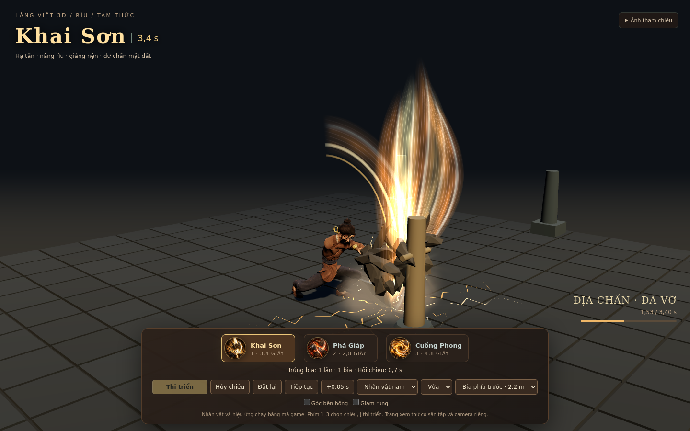
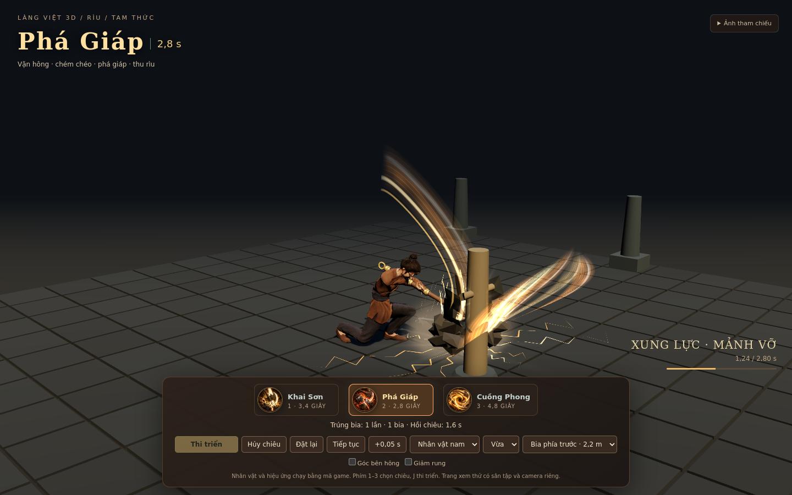
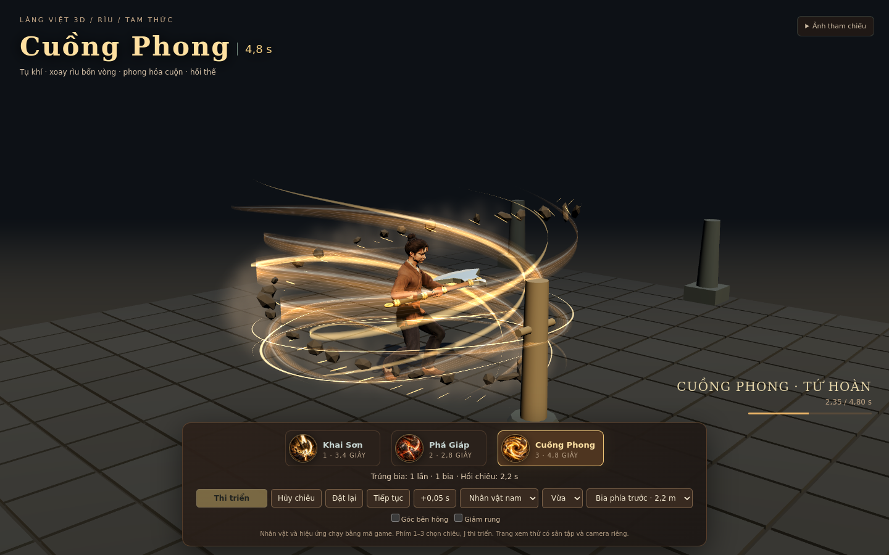

# Kiểm tra Rìu — 22/10/2026

## Phạm vi

Mã game được nối vào host hiện có và được chạy bằng nhân vật GLB nam/nữ, model Rìu và Three.js của dự án. Trang `riu-preview.html` dùng các module này trong sân kiểm tra riêng. Đây không phải bằng chứng đã triển khai Alpha hoặc đã mở toàn bộ MAP trong phiên Claude trên máy người dùng.

## Kiểm tra tự động

Kết quả cuối cùng: **41/41 kiểm thử Rìu, 80/80 kiểm thử hồi quy liên quan và 60/60 tình huống WebGL đạt**; không có lỗi JavaScript/WebGL trong lượt kiểm tra và video. Số liệu máy đọc được nằm trong `test-results.json`, `browser-validation.json` và `video-validation.json`.

41 kiểm thử Rìu gồm 26 runtime, 8 tư thế GLB và 7 tích hợp host. Bộ hồi quy gồm điều khiển nhân vật, vũ khí, VFX chung và tư thế Kiếm/Thương. Ngoài các mốc hồi quy trong test, việc kiểm tra độc lập ở 30Hz đã xét toàn bộ cán, cả chuôi phía sau tay, cùng cẳng tay so với phần thân của hai mô hình.

Bộ kiểm tra Rìu bao gồm:

- Khai Sơn và Phá Giáp: lấy đà, phát lực, đầu lưỡi thực tế chạm đất; đường chém và mặt lưỡi khác nhau.
- Cuồng Phong: thân và vũ khí xoay đủ bốn vòng, các bước chân theo thân, không quay ngược khi hồi thế.
- Hai nhân vật GLB: tay bám cán, giữ chiều dài xương, không dịch chuyển collider theo tư thế hình ảnh, chân không xuyên mặt đất. Nhân vật dự phòng dùng nghiêng thân quanh eo để hai tay với tới cán; kiểm tra cả độ dài cánh tay, chân và tính liên tục tại 60Hz.
- Một mục tiêu chỉ được host xác nhận tối đa một lần mỗi lần thi triển; kiểm tra hướng, độ cao, tầm, mục tiêu di chuyển, tường trước/sau mục tiêu và bước thời gian khác nhau.
- Mảnh giáp chỉ xuất hiện sau va chạm được chấp nhận; hủy trong callback, đổi/cất vũ khí, chết/rời cảnh và mất dữ liệu socket không gây lượt trúng muộn.
- Giữ hồi chiêu và khóa thao tác đến hết hồi thế, dọn tài nguyên VFX, kiểm tra đầu lưỡi thật trên nhân vật dự phòng với hai hướng đứng.

```powershell
npm run test:axe
node --test SOURCE-CODE/tests/player-avatar.test.cjs SOURCE-CODE/tests/weapons-village.test.cjs SOURCE-CODE/tests/weapons-vfx.test.cjs
```

## Chạy WebGL

`browser-validation.json` lưu các tình huống trúng bia, tường chặn, đánh hụt và hủy chiêu trên cả hai nhân vật. Mỗi giới tính chạy ba mức chất lượng với ba chiêu. Kiểm tra kết quả trúng, trạng thái bận và hiệu ứng còn sống sau khi kết thúc.

Môi trường là Chromium 133 với ANGLE SwiftShader. Ảnh được chụp ở 1440×900; ma trận tình huống dùng buffer 480×300, cập nhật logic 1/30 giây và render mỗi 10 bước để kiểm tra shader ở các pha. Những số này mô tả môi trường kiểm tra, không phải benchmark FPS trên máy hoặc điện thoại người dùng.

### Ảnh từ mã thật







Video `Riu-3-Chieu.mp4` ghi đủ ba chuỗi động tác, gồm cả hồi thế, ở 1280×720; H.264, 24 fps mã hóa, không có âm thanh. Không dùng ảnh tạo sinh thay cho khung hình chạy game. Ba icon là tài sản được tạo riêng; xem `icon-manifest.json`.

## Giới hạn và bước tiếp theo

- Host hiện có ghi nhận luyện chiêu vào bia. Không tuyên bố đã có sát thương quái hoặc debuff giảm giáp; Phá Giáp ở bản này có phản hồi hình ảnh khi xác nhận trúng.
- Đã đối soát dependency công khai của trang game: module Rìu, CSS và ba icon được bộ duyệt dependency nhận ra. Chưa chạy trọn `build:hosting` hoặc bộ test toàn game trong snapshot này vì các MAP/NPC/tài sản không thuộc phần cập nhật chưa được tải đầy đủ.
- Chưa chép trực tiếp vào ổ H hoặc phiên Claude. Chưa có phiên Firebase được dùng để deploy Alpha trong lần bàn giao này. Xem `CLAUDE-INTEGRATION.md` để đồng bộ checkout đầy đủ, chạy gate của dự án và kiểm tra URL triển khai thực tế.
