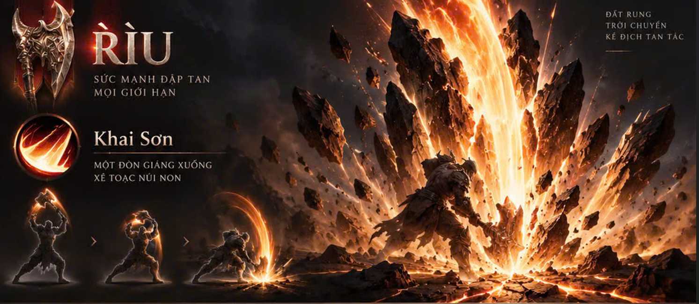
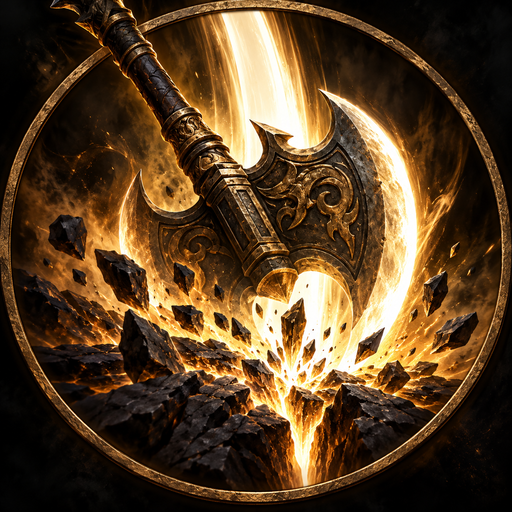
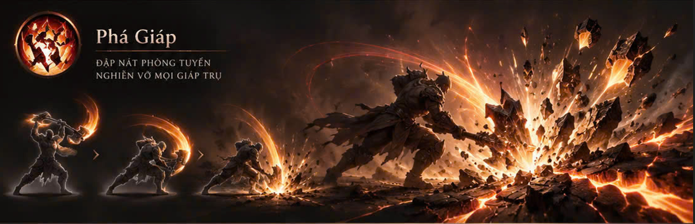
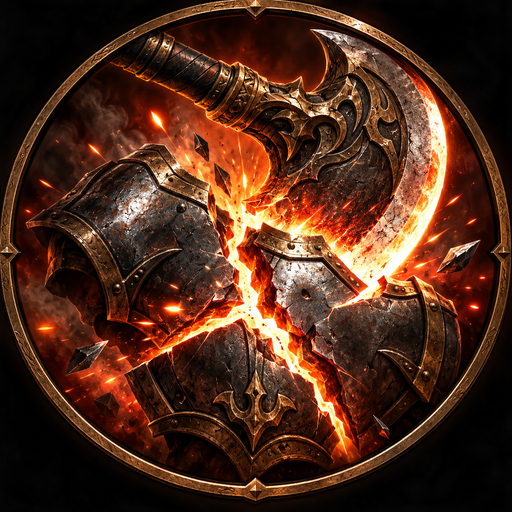
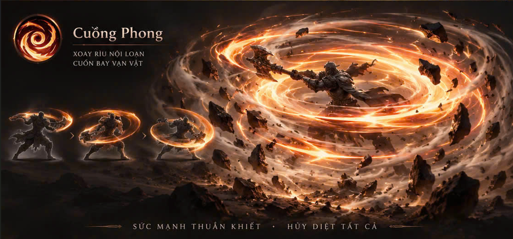
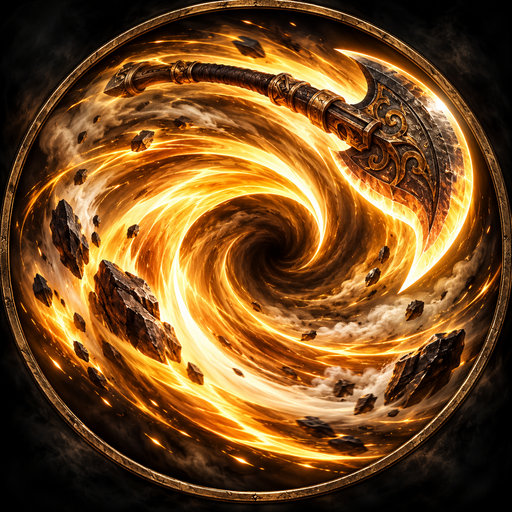

# Rìu — Khai Sơn, Phá Giáp, Cuồng Phong

Bản cập nhật dành cho hệ `axe` của VIET VILLAGE 3D, dựa trên ba ảnh người dùng gửi ngày 22/10/2026. Dùng nhân vật GLB nam/nữ và mô hình Rìu của game. Ảnh cho biết dáng thế và ngôn ngữ hình ảnh; thời lượng và số vòng xoay dưới đây là lựa chọn thiết kế để có đủ lấy đà, phát lực và hồi thế.

| Chiêu | ID hiện có | Thời lượng mới | Hồi chiêu giữ nguyên | Tầm giữ nguyên |
| --- | --- | ---: | ---: | ---: |
| Khai Sơn | `axe.khai-son` | 3,4 s | 2,2 s | 3,3 m |
| Phá Giáp | `axe.pha-giap` | 2,8 s | 2,8 s | 3 m |
| Cuồng Phong | `axe.cuong-phong` | 4,8 s | 4,5 s | 3,6 m |

Hồi chiêu bắt đầu theo cơ chế đang có. Dù hồi chiêu đã hết, nhân vật phải kết thúc động tác trước khi dùng chiêu tiếp theo. Bản cập nhật giữ ID, slot, tầm, bán kính và hồi chiêu; không thêm chỉ số sát thương hoặc thay dữ liệu tiến trình.

## Đối chiếu ảnh và ý đồ động tác

### Khai Sơn





Hai tay đưa rìu qua đầu, chân mở tấn, thân dồn lực rồi giáng một đường bổ đứng. Mép rìu dẫn chuyển động. Vệt khí trắng vàng có viền hổ phách theo đường lưỡi; từ điểm nện xuất hiện khe sáng sát đất, đá đen và cột khí hẹp. Đá tối tạo tương phản với lõi sáng, bụi xuất hiện ở mặt đất. Nhân vật thu rìu và đứng lại khi dư sáng tắt.

### Phá Giáp





Rìu lấy đà lệch vai, hông dẫn một đòn chém chéo dồn về phía trước. Khí cam đỏ mở thành một dải thấp, tập trung quanh hướng chém. Ánh lóe va chạm và các mảnh kim loại chỉ hiện khi mục tiêu được host xác nhận trúng. Đây là phản hồi hình ảnh: phần mã host đang có ghi nhận luyện chiêu vào bia, chưa có trạng thái giảm giáp của quái để nối. Không coi mảnh giáp bay là bằng chứng đã có cơ chế giảm phòng thủ.

### Cuồng Phong





Nhân vật mở rìu, xoay thân và vũ khí bốn vòng trong pha active, hai chân thay nhau chuyển trụ. Những dải khí vàng cam lệch độ cao cuộn quanh người; bụi xám nâu và đá nhỏ bổ sung chiều sâu. Trung tâm lốc giữ thoáng để thấy tay, thân và rìu. Hết pha xoay, khí tản và nhân vật hồi thế; collider và gốc điều khiển không bị xoay theo hiệu ứng hình ảnh.

## Nguyên tắc tích hợp

- `AxeTechniques.spec(id)` và `sample(id, time)` là đồng hồ chung cho tư thế và VFX; `rotation` kiểm soát cả hướng cán và mặt lưỡi.
- Model Rìu hiện có: điểm nắm `(0, -0.6, 0)`, đầu lưỡi `(-0.65, 1.3, 0)`, tỷ lệ gắn `0.7`, xoay gắn `Y = π`. Không thay model bằng một vật sáng đứng tách khỏi bàn tay.
- `startAxeTechnique` / `cancelAxeTechnique` điều khiển tư thế GLB; socket tay phải công bố thời gian và ID để host nhận biết động tác đang chạy.
- Hai tay nắm hai điểm trên cán. Xương không bị kéo dài để đạt tư thế; chân được kiểm tra với mô hình thật.
- Sự kiện truy vấn mục tiêu đi qua host. Mỗi mục tiêu được xác nhận tối đa một lần trong một lần thi triển; vòng lốc, hạt và dư chấn không tự tạo thêm lượt trúng.
- Va chạm vật cản lấy từ `getProjectileBounds`; chưa có dữ liệu vật cản của host thì VFX không tự biết bản đồ. Chất lượng Nhẹ/Vừa/Cao chỉ đổi trang trí, không đổi kết quả xác nhận mục tiêu.
- Hủy, cất/đổi vũ khí, mất liên kết nhân vật hoặc rời cảnh phải thu hồi tư thế và VFX; hồi chiêu vẫn được giữ. Không tạo renderer hay vòng lặp thứ hai trong trang game.

## Tệp và cách chạy

| Phần | Đường dẫn từ gốc dự án |
| --- | --- |
| Cấu hình | `SOURCE-CODE/js/vfx/axe-skill-config.js` |
| Động tác mẫu, va chạm và VFX | `SOURCE-CODE/js/vfx/axe-techniques.js` |
| Đăng ký | `SOURCE-CODE/js/vfx/axe-skill-vfx.js` |
| Tư thế nhân vật | `CHARACTERS/player-gltf.js` |
| Điều phối | `SOURCE-CODE/js/player-avatar.js`, `SOURCE-CODE/js/weapons-village.js`, `SOURCE-CODE/js/app.js` |
| Icon | `ASSETS/ui/skills/axe/` |
| CSS icon | `SOURCE-CODE/css/axe-skill-icons.css` |
| Xem thử | `SOURCE-CODE/riu-preview.html` |
| Kiểm thử | `SOURCE-CODE/tests/axe-techniques.test.cjs`, `axe-pose.test.cjs`, `axe-integration.test.cjs` |

Thứ tự nạp: `weapon-vfx-core` → các dependency va chạm `bow-piercing` → `axe-skill-config` → `axe-techniques` → `axe-skill-vfx`. Dùng Three.js r160 hiện có. Icon PNG được tạo riêng bằng công cụ tạo ảnh; ảnh runtime và video phải lấy từ mã WebGL thật. Tên chiêu, phím và hồi chiêu vẫn là chữ giao diện, không in vào ảnh icon.

```powershell
npm run test:axe
.\START-GAME.bat --port 8002
```

Mở `/SOURCE-CODE/riu-preview.html` trên URL localhost do launcher trả về. Dùng launcher của dự án vì nó lọc các đường dẫn dữ liệu riêng. Trang thử cho chọn nam/nữ, chất lượng, bia/tường/hụt, góc nhìn, tạm dừng và bước thời gian; đây là sân kiểm tra riêng, không chứng minh Alpha đã triển khai.

Gói bàn giao `Riu-3-Chieu.zip` chứa lớp cập nhật, không phải toàn bộ game. Đặt ZIP và `Riu-3-Chieu.mp4` tại `H:\CHAT GPT\3D-GAME\SKILL-THAM-CHIEU` để Claude đọc khi làm việc trên máy người dùng. Xem [hướng dẫn Claude](CLAUDE-INTEGRATION.md) và [kết quả kiểm tra](QA.md).
