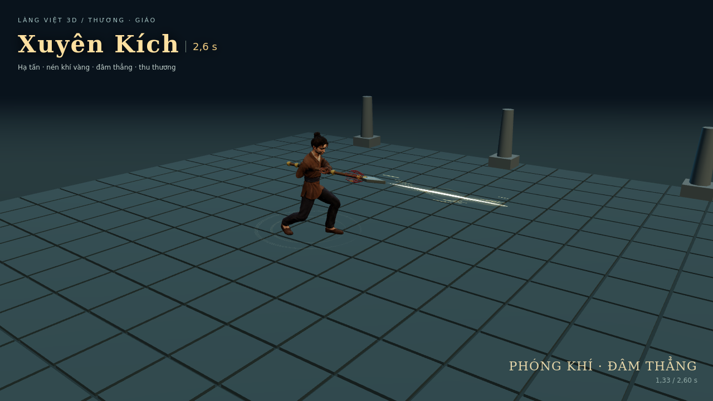
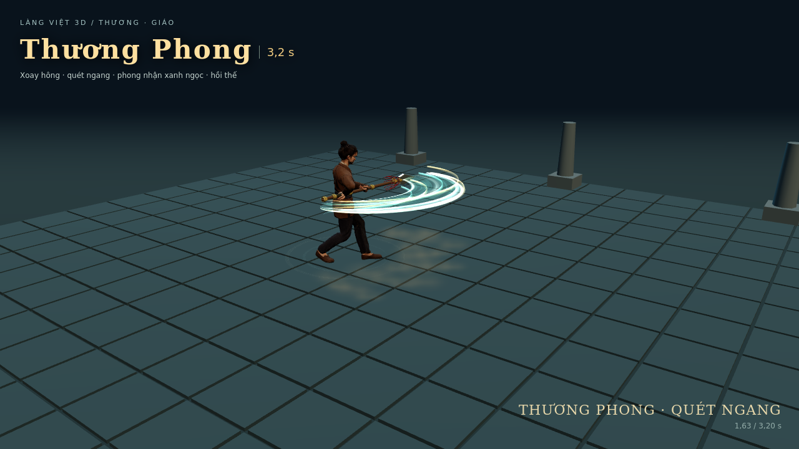
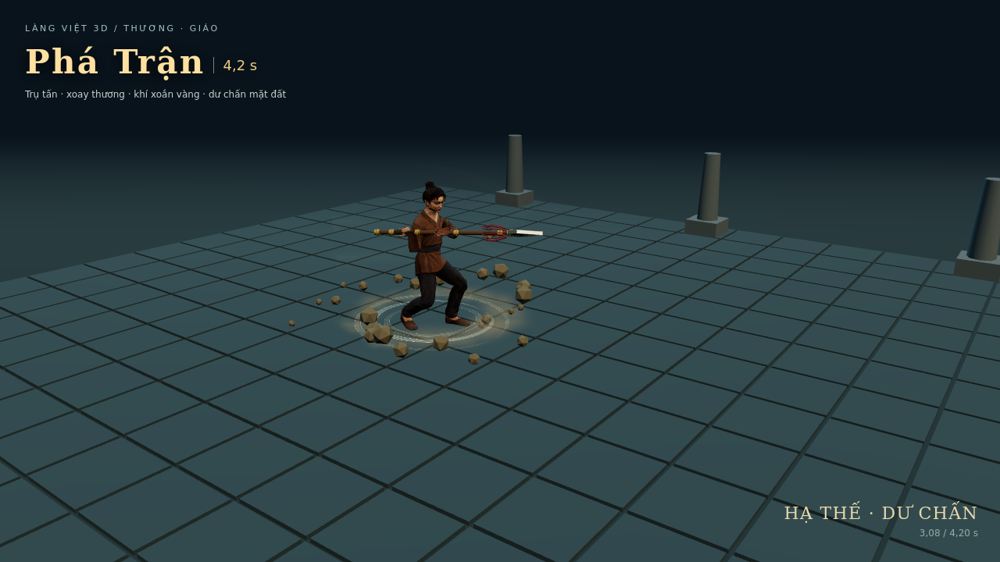

# Kiểm tra bộ ba chiêu Thương / Giáo — 21/10/2026

Mã được xây trên `thanhmade/viet-village-3d`, nhánh `cap-nhat`, commit nền `bac0872d7eef72fe5de6aaa1ef676109bf7a2f96`. Giữ bản sửa chân trượt khi idle của commit nền. Đây là kết quả chạy cục bộ trên dữ liệu GLB và mã game thật, không phải xác nhận đã triển khai Alpha.

## Kết quả

| Phần kiểm tra | Kết quả | Phạm vi |
| --- | --- | --- |
| `npm run test:spear` | 34/34 đạt | 27 runtime, 4 pose GLB, 3 tích hợp điều khiển |
| Động tác Côn/Cung/Kiếm đang có | 34/34 đạt | Tám tệp kiểm thử pose, cả GLB nam và nữ |
| Core VFX và điều khiển vũ khí | 34/34 đạt | Hoàn tất, cleanup, chất lượng, trang bị, hồi chiêu, điều khiển và tương thích chiêu cũ |
| Avatar và chuyển động | 20/20 avatar; 7/7 motion đạt | Gọi đúng pose Thương, chặn khi nhảy, hủy/đổi nhân vật và các hành vi cũ |
| Cảnh WebGL thực tế | 60/60 tình huống đạt | 2 giới tính × 3 chất lượng × 3 chiêu × 3 tình huống trúng/tường/hụt; thêm 6 tình huống hủy |
| Lỗi JavaScript/WebGL shader trong lượt quay và kiểm tra | 0 | Chromium 133, ANGLE SwiftShader |
| Dependency Hosting mới | Đạt | Bộ thu thập dependency nhận module, CSS và đủ 3 icon |

`browser-validation.json` ghi kết quả 60 tình huống. Các số draw call trong báo cáo là toàn cảnh xem thử, không phải FPS hoặc số riêng của chiêu.

Kiểm thử pose đọc xương, hoạt ảnh và đỉnh bàn chân của hai GLB thực tế; kiểm tra hai điểm bám cán, chiều dài xương, gốc nhân vật, chân chạm nền, hủy và hai vòng xoay Phá Trận ở bước thời gian 30/60/120 Hz. Bộ runtime kiểm tra bước thời gian lớn, mục tiêu sát người, bia gần/xa, vật cản, một lần trúng mỗi mục tiêu, callback hủy trong lúc giải quyết va chạm và cleanup ở ba mức chất lượng.

Đã sửa qua đối soát: tay trước mẫu nữ vượt tầm với; Xuyên Kích bỏ lọt bia sát người; dải khí xoay ngược hướng ở avatar dự phòng. GLB dùng khoảng cách hai tay 0,55 m; avatar dự phòng tay ngắn dùng 0,42 m, vẫn là hai điểm khác nhau trên cán.

## Hình chạy thật

Các hình dưới đây lấy trực tiếp từ WebGL, khác với icon minh họa được tạo riêng.





Video bàn giao `Thuong-Giao-3-Chieu.mp4`: H.264, 1280×720, 292 khung hình, 12,167 giây, 24 khung hình/giây khi mã hóa. Khung hình được dựng tuần tự bằng cùng mã WebGL/GLB và timeline thật. **24 fps là tốc độ video xuất ra, không phải phép đo hiệu năng chơi game**. Video không có bản âm thanh hoàn thiện.

## Giới hạn còn lại

- Chưa chạy trên GPU/điện thoại thật, chưa đo FPS, GPU time hoặc bộ nhớ GPU của máy người chơi.
- Chưa chạy toàn bộ `npm test` hay full Hosting build trong checkout cục bộ này; dữ liệu NPC/MAP/learning ngoài phạm vi chưa được tải đầy đủ. Bộ thu thập dependency của Hosting đã kiểm tra được các tệp mới.
- Chưa thao tác được thư mục ổ H trên máy người dùng. Trình duyệt Claude khả dụng của phiên này đang ở trang đăng nhập; điều đó không mô tả trạng thái Claude đang mở trên máy người dùng.
- Chưa triển khai hoặc smoke test Alpha cho bản Thương/Giáo này. Mã nguồn, video và hướng dẫn đồng bộ là các đầu ra đã thực hiện; kiểm tra máy đích/Alpha theo `CLAUDE-INTEGRATION.md`.

## Lệnh đã chạy

```sh
npm run test:spear
node --test SOURCE-CODE/tests/weapons-vfx.test.cjs SOURCE-CODE/tests/weapons-village.test.cjs
node --test SOURCE-CODE/tests/kiem-khi-pose.test.cjs SOURCE-CODE/tests/kiem-hoa-pose.test.cjs SOURCE-CODE/tests/nhat-kiem-pose.test.cjs SOURCE-CODE/tests/mua-ten-pose.test.cjs SOURCE-CODE/tests/lien-tien-pose.test.cjs SOURCE-CODE/tests/xuyen-tien-pose.test.cjs SOURCE-CODE/tests/staff-end-grip.test.cjs SOURCE-CODE/tests/chan-dia-pose.test.cjs
node --test SOURCE-CODE/tests/player-avatar.test.cjs SOURCE-CODE/tests/player-motion.test.cjs
```

Các kiểm tra đã chạy theo nhóm, bao gồm chạy lại kiểm tra bị ảnh hưởng sau khi sửa. Kết quả avatar 20/20 gồm 19 ca đạt trong lượt đầy đủ và ca điều phối Thương được sửa rồi chạy lại thành công.
