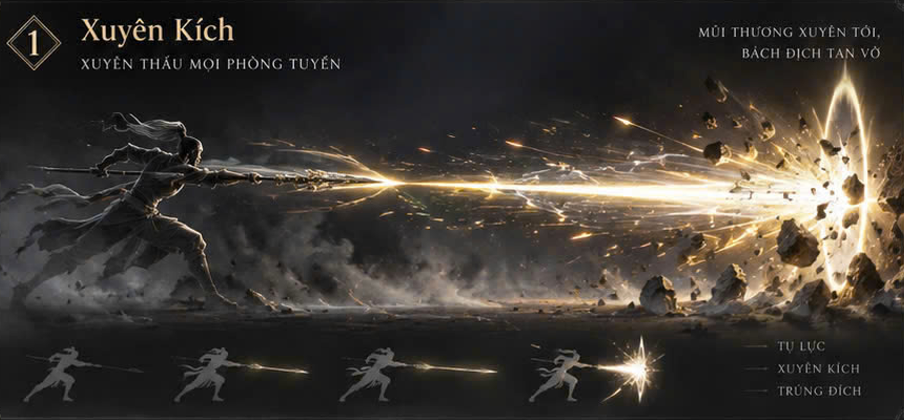
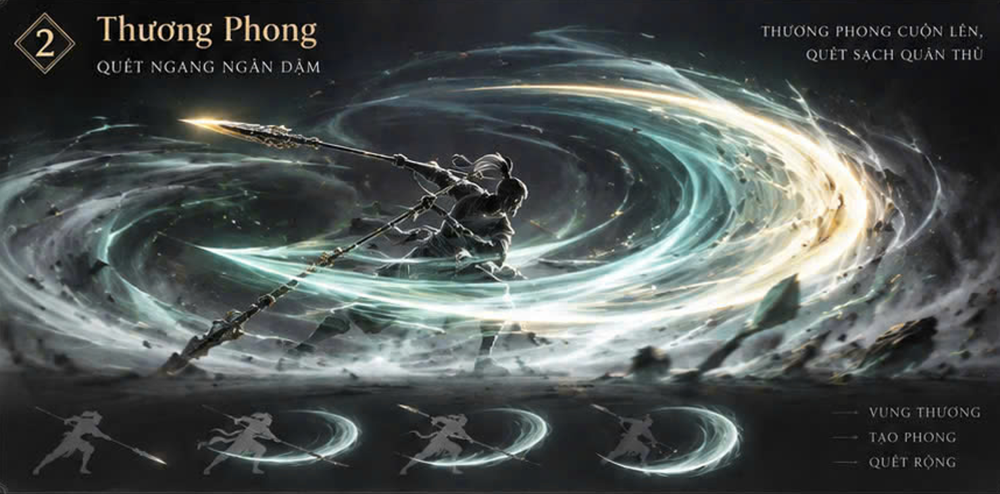
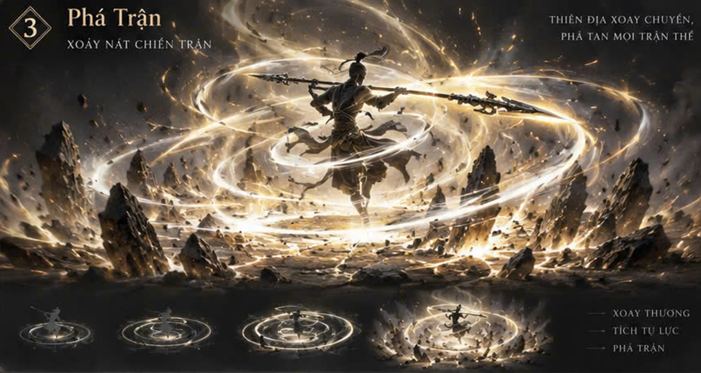

# Thương / Giáo — Xuyên Kích, Thương Phong, Phá Trận

Bộ ba chiêu dùng nhân vật, vũ khí và vòng cập nhật hiện có của Làng Việt 3D. Thiết kế dựa trên ba ảnh người dùng cung cấp: khí đâm vàng trắng, phong nhận xanh ngọc và vòng khí xoắn vàng. Thời lượng dưới đây là lựa chọn thiết kế để đọc rõ động tác; ảnh tĩnh không xác định được thời gian chuyển động.

| Chiêu | ID giữ nguyên | Tổng thời gian | Khoảng phát lực | Hồi chiêu giữ nguyên | Tầm giữ nguyên |
| --- | --- | ---: | --- | ---: | ---: |
| Xuyên Kích | `spear.xuyen-kich` | 2,6 giây | 1,04–1,58 giây | 1,3 giây | 6 m |
| Thương Phong | `spear.thuong-phong` | 3,2 giây | 1,05–1,78 giây | 2 giây | 3,8 m |
| Phá Trận | `spear.pha-tran` | 4,2 giây | 1,15–2,75 giây | 4 giây | 4,3 m |

Hồi chiêu và động tác là hai đồng hồ riêng. Dù hồi chiêu đã hết, nhân vật vẫn phải kết thúc động tác hiện tại mới dùng được chiêu tiếp theo. Bản cập nhật không thêm chỉ số sát thương; phần chiến đấu của game tiếp tục quyết định mục tiêu hợp lệ và xử lý kết quả trúng đòn.

## Hình tham chiếu và icon

### Xuyên Kích




Nhân vật hạ tấn, kéo thương lấy đà và dồn khí về mũi. Lúc phát lực, chân và hông dẫn động tác đâm; khí có lõi trắng hẹp, vỏ vàng và các sợi sáng chạy dọc. Vòng lóe va chạm chỉ xuất hiện khi thực sự chạm mục tiêu hoặc vật cản. Bắn hụt thì khí tan.

### Thương Phong




Nhân vật hạ trọng tâm, vặn hông rồi quét thương ngang một đường rộng. Lưỡi gió xanh ngọc có lõi sáng và viền vàng nhạt, chuyển động cùng cung quét của thương. Thân người theo đà rồi thu thế; đây là một lượt quét, không áp dụng kiểu xoay liên tục của Côn Quét.

### Phá Trận




Nhân vật trụ tấn, mở thương và xoay thân cùng vũ khí hai vòng. Những dải khí vàng có độ cao khác nhau tạo chiều sâu quanh người, sau đó tản thành dư chấn sát mặt đất và đá nhỏ. Dư chấn cuối tại 2,88 giây là hiệu ứng hình ảnh (`visualOnly`), không tạo lượt sát thương bổ sung.

## Nhịp động tác

| Chiêu | Chuẩn bị | Phát lực | Theo đà và hồi thế |
| --- | --- | --- | --- |
| Xuyên Kích | 0–0,42 s: hạ tấn; 0,42–0,88 s: nén lực | 0,88–1,04 s: đạp chân, đâm; 1,04–1,58 s: khí đi thẳng | 1,58–1,85 s: giữ đà; 1,85–2,60 s: thu thương |
| Thương Phong | 0–0,55 s: hạ tấn; 0,55–1,05 s: vặn hông | 1,05–1,78 s: quét ngang | 1,78–2,45 s: gió mở, thân theo đà; 2,45–3,20 s: hồi thế |
| Phá Trận | 0–0,60 s: trụ bộ; 0,60–1,15 s: mở thương | 1,15–2,75 s: thân và thương xoay hai vòng | 2,75–3,10 s: hạ thế, dư chấn tại 2,88 s; 3,10–4,20 s: khí tản |

Động tác áp dụng lên bộ xương nhân vật nam và nữ đang có. Tay phải giữ phía sau cán, tay trái dẫn cán ở điểm cách tay phải 0,55 m theo trục thương. Thương gắn vào bàn tay thật; chuyển động chân, hông và thân đi cùng vũ khí. Vòng xoay thuộc phần hình ảnh của nhân vật, không xoay gốc điều khiển, collider hay camera của game.

## Hợp đồng tích hợp

- `SpearTechniques.spec(id)` cung cấp các mốc thời gian; `sample(id, time)` cung cấp tư thế và giai đoạn.
- `rotation(...)` và `authoredTip(...)` dùng cùng quy ước trục thương `+Y`, nhân vật nhìn `+Z`; bộ phát VFX dùng caster quay về `-Z` theo hợp đồng lõi hiện có.
- `startSpearTechnique(id)` và `cancelSpearTechnique()` điều khiển tư thế nhân vật. Socket tay phải công bố thời gian chiêu để phần hiệu ứng và động tác được liên kết.
- Mỗi mục tiêu chỉ được xác nhận trúng tối đa một lần trong một lần thi triển. Callback kiểm tra mục tiêu chỉ có hiệu lực trong lần phát sự kiện tương ứng; không giữ callback để gây trúng đòn về sau.
- Xuyên Kích kiểm tra đường đi liên tục, chặn ở mục tiêu hợp lệ gần nhất hoặc vật cản. Thương Phong và Phá Trận kiểm tra các lát quét cùng đường che khuất đến mục tiêu; dải sáng trang trí không tạo thêm hit.
- Mức Nhẹ/Vừa/Cao thay số phần tử hình ảnh. Quy tắc chọn mục tiêu, vật cản và số lần trúng không thay đổi theo mức chất lượng.
- Hủy chiêu, đổi hoặc cất vũ khí, rời cảnh và trạng thái nhân vật không cho thi triển phải dừng tư thế, thu hồi hiệu ứng. Việc đổi vũ khí không xóa hồi chiêu đã phát sinh.

Tường và vật cản phải được host cung cấp qua `getProjectileBounds`; không có dữ liệu vật cản thì mô-đun không thể tự biết hình dạng bản đồ. Không thêm renderer hoặc vòng `requestAnimationFrame` thứ hai vào game. Trang preview có renderer và vòng lặp riêng vì đó là trang độc lập.

## Vị trí mã và tài sản

| Thành phần | Đường dẫn tính từ gốc dự án |
| --- | --- |
| Thông số ba chiêu | `SOURCE-CODE/js/vfx/spear-skill-config.js` |
| Tư thế mẫu, va chạm và VFX | `SOURCE-CODE/js/vfx/spear-techniques.js` |
| Đăng ký hệ Thương / Giáo | `SOURCE-CODE/js/vfx/spear-skill-vfx.js` |
| Tư thế GLB và bộ điều phối nhân vật | `CHARACTERS/player-gltf.js`, `SOURCE-CODE/js/player-avatar.js` |
| Thi triển, khóa di chuyển, hủy và vũ khí | `SOURCE-CODE/js/weapons-village.js` |
| Thứ tự nạp và trang game | `SOURCE-CODE/load-order.json`, `SOURCE-CODE/index.html` |
| Icon | `ASSETS/ui/skills/spear/xuyen-kich-gold.png`, `thuong-phong-jade.png`, `pha-tran-gold.png` trong cùng thư mục |
| Gắn icon lên nút | `SOURCE-CODE/css/spear-skill-icons.css` |
| Trang chạy thử | `SOURCE-CODE/thuong-giao-preview.html` |
| Kiểm thử riêng | `SOURCE-CODE/tests/spear-techniques.test.cjs`, `spear-pose.test.cjs`, `spear-integration.test.cjs` trong cùng thư mục |

Icon dùng ảnh PNG gốc được tạo cho từng chiêu. Tên chiêu, phím bấm và hồi chiêu vẫn là chữ giao diện để dễ đọc và hỗ trợ khả năng truy cập; không ghép các chữ đó vào ảnh.

## Chạy và kiểm tra

Từ gốc dự án đã có đủ mã, thư viện Three.js và hai mô hình `CHARACTERS/PLAYER/MALE/PLAYER_BASE_MALE_GLB.glb`, `CHARACTERS/PLAYER/FEMALE/PLAYER_BASE_FEMALE_GLB.glb`:

```powershell
npm run test:spear
node --test SOURCE-CODE/tests/kiem-khi-pose.test.cjs SOURCE-CODE/tests/kiem-hoa-pose.test.cjs SOURCE-CODE/tests/nhat-kiem-pose.test.cjs SOURCE-CODE/tests/player-avatar.test.cjs SOURCE-CODE/tests/weapons-village.test.cjs
.\START-GAME.bat --port 8002
```

Mở <http://localhost:8002/SOURCE-CODE/thuong-giao-preview.html> trên URL cục bộ mà launcher cung cấp. Dùng launcher của dự án vì nó lọc các đường dẫn dữ liệu đáp án và dữ liệu thử theo tài khoản; không chạy máy chủ tĩnh thông thường tại gốc repository. Trang preview này dành cho môi trường phát triển; bản Hosting mặc định không đóng gói các ảnh tham chiếu trong thư mục tài liệu.

Chọn nam/nữ, từng chiêu và tình huống trúng bia, sân trống, vách sát người, vách sau bia, nhiều bia, bia sau lưng. Dùng tạm dừng và bước `+0,05 s` để xem tay nắm cán, chân chạm đất và mốc phát lực. Phím `1`–`3` chọn chiêu, `J` thi triển.

Tự động hóa có thể mở `?test&skill=xuyen-kich&gender=male&quality=medium&scenario=hit`, rồi gọi `window.spearPreview.cast()` và `step(dt)`. Hai tên chiêu còn lại là `thuong-phong`, `pha-tran`; `setCapture(true)` ẩn bảng điều khiển khi ghi hình. Video có số khung hình cố định không phải kết quả đo FPS chạy game.

Xem [hướng dẫn đưa vào Claude](CLAUDE-INTEGRATION.md) và [biên bản kiểm tra thực tế](QA.md). Chỉ dùng các kết quả đã được ghi trong biên bản; README này không tự xác nhận các bài kiểm thử đã đạt hay Alpha đã được triển khai.
